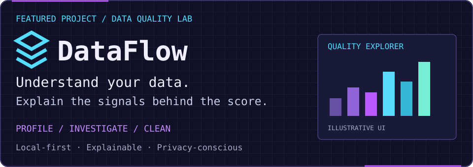
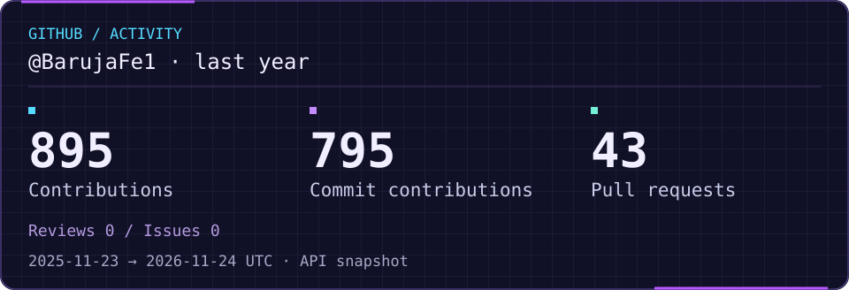

  

# Felipe Baruja

**Statistics, Data Science & Software Engineering** 
Statistics and Data Science student at the University of São Paulo · USP / ICMC

I build data products at the intersection of statistical reasoning, software engineering and AI-assisted systems. I care about explainable results, usable interfaces and software that works under real constraints.

[LinkedIn](https://www.linkedin.com/in/barujafe/) · [Email](mailto:felipebaruja@usp.br) · [GitHub](https://github.com/BarujaFe1)

## DataFlow

**My flagship project: a local-first data quality lab for understanding tabular data before trusting it.**

- Profile CSV datasets and investigate column-level quality issues.
- Explore explainable quality scores and statistical evidence.
- Track cleaning decisions with before/after audit trails.
- Experiment with privacy-conscious PII masking and executive briefings.

`Next.js` · `TypeScript` · `FastAPI` · `SciPy` · `Tailwind CSS`

**[Explore the repository →](https://github.com/BarujaFe1/DataFlow)** · **[Try the demo →](https://dataflow-sand.vercel.app)**

Lab / demo. Scores support interpretation; masking is experimental. The public demo may differ from the full API-backed experience.

## Selected projects

**[ForecastOps](https://github.com/BarujaFe1/ForecastOps)** — Operational forecasting, temporal backtesting and uncertainty-aware scenarios. 
`TypeScript` · `React` · `D3` · [Demo](https://barujafe1.github.io/ForecastOps/)

**[metric-contract-studio](https://github.com/BarujaFe1/metric-contract-studio)** — Define, validate and export metric contracts for analytics engineering. 
`Next.js` · `TypeScript` · `Tailwind CSS` · [Demo](https://metric-contract-studio.vercel.app)

**[LancaEnsaio](https://github.com/BarujaFe1/LancaEnsaio)** — Field data collection for agricultural trials, with offline workflows and synchronization. 
`Expo` · `React Native` · `Supabase`

**[CausalForge](https://github.com/BarujaFe1/CausalForge)** — An archived exploration of causal inference, matching and decision memos. 
`FastAPI` · `Next.js` · `SciPy` · `Statsmodels`

## Tools I work with

**Data & statistics** · Python, SQL, Pandas, NumPy, SciPy, statsmodels, scikit-learn 
**Products & interfaces** · TypeScript, React, Next.js, Tailwind CSS, Expo 
**APIs & local-first systems** · FastAPI, Node.js, PostgreSQL, SQLite, IndexedDB 
**Engineering** · Git, GitHub Actions, Docker, Linux, Vitest, Playwright

## How I build

- Evidence before claims: distinguish prototypes, tested behavior and live integrations.
- Statistical rigor: respect temporal boundaries and communicate uncertainty.
- Resilient products: make offline workflows and recovery part of the design.
- Clear interfaces: help people understand the result and its limits.

## GitHub activity

Generated from the GitHub API. Counts reflect the selected window and token visibility; the last successful snapshot stays visible if an update fails. [How it updates](docs/profile-assets.md).

---

Have a data problem or a product idea? <a href="mailto:felipebaruja@usp.br">Let's talk.</a>

